# Manuel d'utilisation vendeur

Ce manuel explique comment utiliser le dashboard CafThé au quotidien en boutique :
consulter les chiffres, gérer les produits, enregistrer une vente, suivre les commandes du site
et les fiches clients.

Adresse du dashboard : https://dashboard-cafthe.slaurent.dev-campus.fr

## Sommaire

1. [Connexion](#1-connexion)
2. [Le menu](#2-le-menu)
3. [Tableau de bord](#3-tableau-de-bord)
4. [Produits](#4-produits)
5. [Vente en magasin](#5-vente-en-magasin)
6. [Commandes](#6-commandes)
7. [Clients](#7-clients)
8. [Mon profil et mot de passe](#8-mon-profil-et-mot-de-passe)
9. [Administrateur : gestion des vendeurs](#9-administrateur--gestion-des-vendeurs)

---

## 1. Connexion

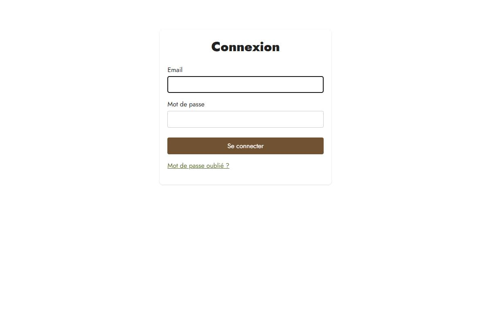

1. Saisissez votre **Email** et votre **Mot de passe**.
2. Cliquez sur **Se connecter**. Le tableau de bord s'affiche.

Si le message « Email ou mot de passe incorrect » apparaît, vérifiez votre saisie
(attention aux majuscules). Le message est le même que l'email soit inconnu ou que le mot de passe
soit faux : c'est voulu, pour ne pas indiquer quels comptes existent.

### Mot de passe oublié

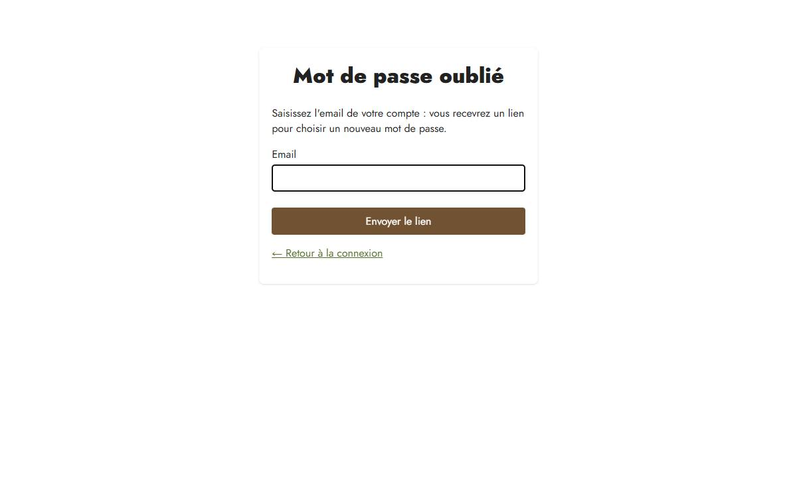

1. Sur la page de connexion, cliquez sur **Mot de passe oublié ?**.
2. Saisissez l'email de votre compte et cliquez sur **Envoyer le lien**.
3. Ouvrez l'email reçu (objet « CafThé - Réinitialisation du mot de passe ») et cliquez sur le lien.
4. Saisissez votre nouveau mot de passe deux fois, puis cliquez sur **Enregistrer le mot de passe**.
5. Connectez-vous avec ce nouveau mot de passe.

À savoir :

- Le lien est valable **1 heure** et ne sert **qu'une seule fois**.
- Si vous demandez plusieurs liens, seul le dernier fonctionne.
- Le message affiché après la demande est toujours le même, que l'email corresponde à un compte ou non.
  Si vous ne recevez rien, vérifiez l'adresse saisie et votre dossier de courriers indésirables.
- Après 5 demandes en un quart d'heure, il faut attendre quelques minutes avant de recommencer.
- Si le lien affiche « Ce lien n'est plus valable », il a expiré ou a déjà servi :
  cliquez sur **Demander un nouveau lien**.

Le mot de passe doit contenir **au moins 8 caractères, avec une majuscule, une minuscule et un chiffre**.

### Déconnexion

- Pour quitter le dashboard, cliquez sur **Déconnexion** en haut à droite.
- Sans aucune action pendant **30 minutes**, vous êtes déconnecté automatiquement. Le message
  « Session expirée après 30 minutes d'inactivité, reconnectez-vous. » s'affiche : il suffit de se
  reconnecter. Pensez à vous déconnecter si vous quittez le poste de caisse.

---

## 2. Le menu

La barre du haut donne accès à toutes les pages :

| Lien | Contenu |
|---|---|
| Tableau de bord | Chiffres de vente |
| Vente magasin | Enregistrer un achat en boutique |
| Commandes | Commandes du site et ventes en magasin |
| Produits | Catalogue, stock, prix |
| Clients | Fiches clients et historique d'achat |
| Vendeurs | Comptes du personnel (visible uniquement par l'administrateur) |
| Votre prénom | Votre profil et le changement de mot de passe |
| Déconnexion | Quitter le dashboard |

Après chaque action (enregistrement, modification), un message vert confirme l'opération.
Un message rouge signale une erreur ; dans un formulaire, l'erreur est écrite sous le champ concerné.

---

## 3. Tableau de bord

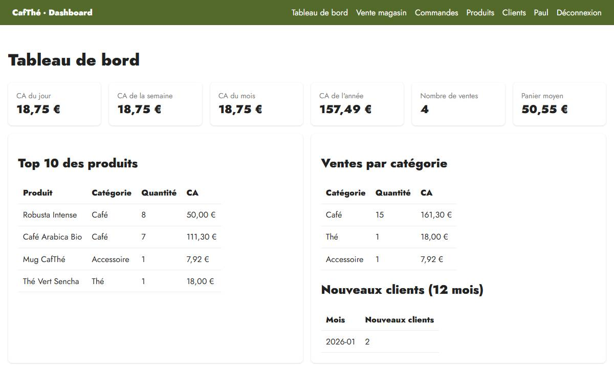

Les chiffres regroupent les ventes en magasin et les commandes passées sur le site.
Les montants sont TTC (frais de livraison compris pour les commandes du site).

| Indicateur | Signification |
|---|---|
| CA du jour | Chiffre d'affaires d'aujourd'hui |
| CA de la semaine | Chiffre d'affaires depuis lundi |
| CA du mois | Chiffre d'affaires depuis le 1er du mois |
| CA de l'année | Chiffre d'affaires depuis le 1er janvier |
| Nombre de ventes | Nombre total de commandes enregistrées (magasin et site) |
| Panier moyen | Montant moyen d'une commande |

En dessous :

- **Top 10 des produits** : les produits les plus vendus en quantité, avec le chiffre d'affaires de chacun.
  Pour un produit vendu au poids, la quantité est un nombre de tranches de 100 g.
- **Ventes par catégorie** : quantités et chiffre d'affaires pour le thé, le café et les accessoires.
- **Nouveaux clients (12 mois)** : nombre de clients créés chaque mois (inscription sur le site ou fiche
  créée en boutique).

---

## 4. Produits

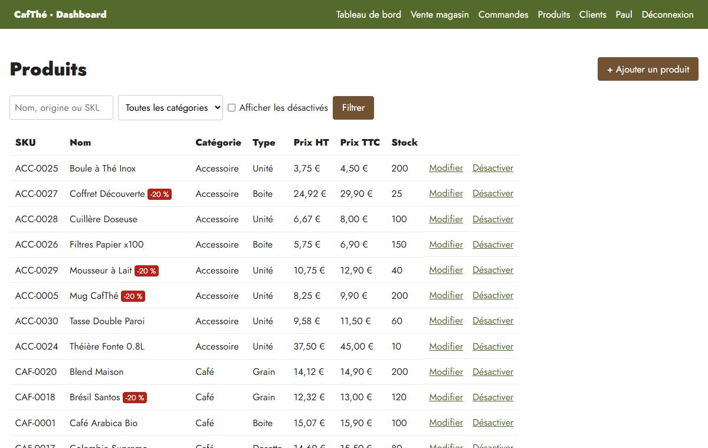

### Rechercher un produit

- Tapez un nom, une origine ou une référence SKU dans le champ de recherche
  (une partie suffit : « THE-001 », « Japon », « Earl »).
- Choisissez éventuellement une catégorie.
- Cochez **Afficher les désactivés** pour voir aussi les produits retirés de la vente (ils apparaissent grisés).
- Cliquez sur **Filtrer**.

Un badge « -20 % » à côté du nom indique un produit en promotion.

### Ajouter un produit

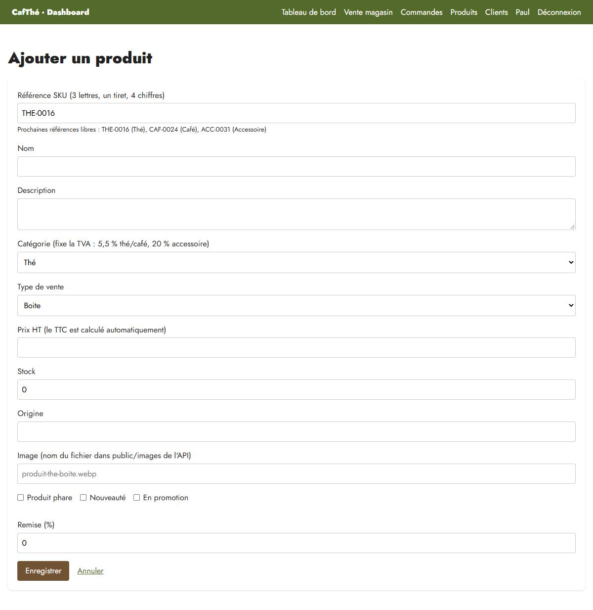

Cliquez sur **+ Ajouter un produit**, remplissez le formulaire puis cliquez sur **Enregistrer**.

| Champ | Explication |
|---|---|
| Référence SKU | Code unique du produit : 3 lettres, un tiret, 4 chiffres (ex. THE-0016). Voir ci-dessous. |
| Nom | 50 caractères maximum |
| Description | 255 caractères maximum, affichée sur le site |
| Catégorie | Thé, Café ou Accessoire. Elle fixe la TVA. |
| Type de vente | À l'unité (Boite, Sachet, Dosette, Unité) ou au poids (Vrac, Grain) |
| Prix HT | Prix hors taxes. Le prix TTC est calculé automatiquement. |
| Stock | Quantité disponible |
| Origine | Pays ou région de provenance |
| Image | Nom du fichier image utilisé par le site. Laissé vide, une image par défaut est utilisée. |
| Produit phare, Nouveauté | Mise en avant sur le site |
| En promotion et Remise (%) | La remise (de 0 à 90 %) n'est appliquée que si la case « En promotion » est cochée |

**Référence SKU.** Chaque produit a sa propre référence : deux produits ne peuvent pas avoir la même.
Le formulaire propose la prochaine référence libre de chaque catégorie
(par exemple « THE-0016 (Thé), CAF-0024 (Café), ACC-0031 (Accessoire) »).
Si vous changez la catégorie, reprenez la référence proposée pour cette catégorie.
Les minuscules sont acceptées et converties en majuscules. Si la référence est déjà prise, le message
« Cette référence SKU est déjà utilisée par un autre produit » s'affiche : choisissez-en une autre.

**TVA automatique.** Vous ne saisissez jamais la TVA ni le prix TTC :

- Thé et Café : TVA 5,5 % (10,00 € HT donnent 10,55 € TTC)
- Accessoire : TVA 20 % (10,00 € HT donnent 12,00 € TTC)

**Vente à l'unité ou au poids.**

- À l'unité : le prix et le stock sont exprimés par article (une boîte, un sachet, un mug).
- Au poids (Vrac, Grain) : le prix et le stock sont exprimés **pour 100 g**.
  Un stock de 90 correspond à 9 kg ; un prix de 10,50 € correspond à 10,50 € les 100 g.

### Modifier un produit

Dans la liste, cliquez sur **Modifier** sur la ligne du produit, changez les champs voulus puis
cliquez sur **Enregistrer**. Le prix TTC est recalculé.

### Désactiver ou réactiver un produit

Un produit n'est jamais supprimé : il est **désactivé**, pour garder l'historique des commandes.

- **Désactiver** : le produit disparaît du site et de la vente en magasin.
- **Réactiver** : cochez « Afficher les désactivés », filtrez, puis cliquez sur **Réactiver**.

---

## 5. Vente en magasin

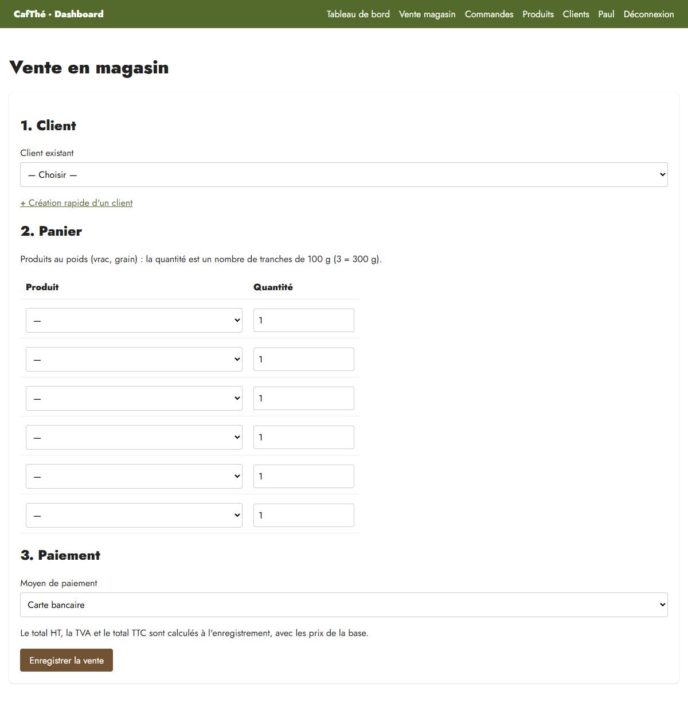

Cliquez sur **Vente magasin** dans le menu (ou sur **Nouvelle vente** depuis une fiche client).

**Étape 1 : le client**

- Choisissez le client dans la liste **Client existant** (nom, prénom et email).
- S'il n'a pas encore de fiche, cliquez sur **+ Création rapide d'un client**, remplissez la fiche
  (voir [Clients](#créer-une-fiche-client)) : vous revenez ensuite à la vente avec ce client déjà choisi.

**Étape 2 : le panier**

- Sur chaque ligne, choisissez un produit et indiquez la quantité (6 lignes disponibles).
- La liste montre le prix réellement payé (remise déduite), la mention « / 100 g » pour les produits
  au poids, et le stock restant. Seuls les produits actifs et en stock sont proposés.
- Produit au poids : la quantité est un nombre de tranches de 100 g. Pour 300 g, saisissez 3.
- Si le même produit est choisi sur deux lignes, les quantités sont additionnées.
- Laissez les lignes inutiles sans produit.

**Étape 3 : le paiement**

- Choisissez **Carte bancaire**, **Espèces** ou **Chèque**.
- Cliquez sur **Enregistrer la vente**.

La page de la commande s'affiche avec le message « Vente enregistrée, stock mis à jour » et le détail :
total HT, TVA et total TTC. La vente est considérée comme payée et remise au client
(statut « Livrée »). Le stock des produits est diminué immédiatement.

Si un problème est détecté, **rien n'est enregistré** et un message l'explique :

| Message | Que faire |
|---|---|
| Choisissez un client | Sélectionner un client à l'étape 1 |
| Ajoutez au moins un produit | Choisir au moins un produit avec une quantité |
| Stock insuffisant pour « nom du produit » | Diminuer la quantité (le stock disponible est affiché dans la liste) |
| Produit … introuvable ou désactivé | Le produit a été désactivé entre-temps : en choisir un autre |

---

## 6. Commandes

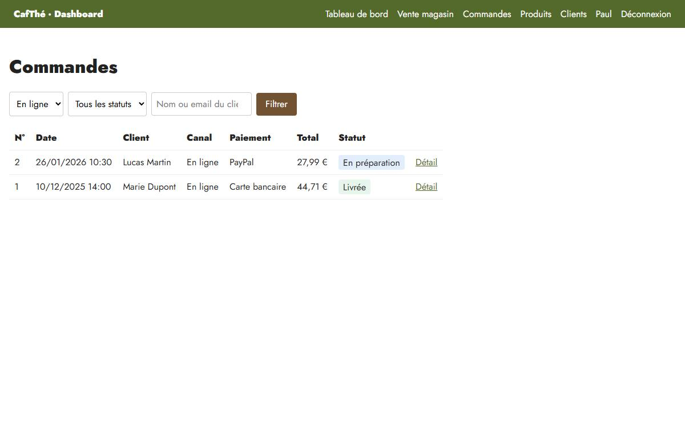

La page affiche par défaut les **commandes en ligne** (passées sur le site).

### Filtrer

- Canal : **En ligne**, **Magasin** ou **Toutes**.
- Statut : En attente, En préparation, Expédiée, Livrée.
- Client : une partie du nom ou de l'email.
- Cliquez sur **Filtrer**, puis sur **Détail** pour ouvrir une commande.

### Détail d'une commande et statut

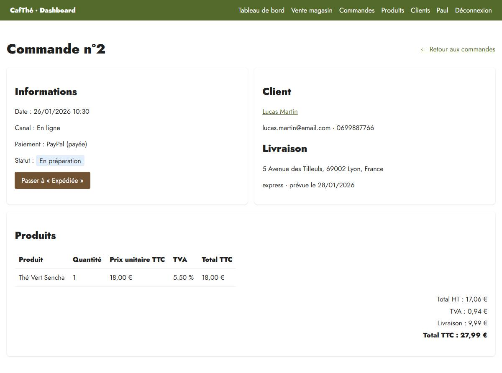

La page montre la date, le canal, le moyen de paiement (payée ou non), le client, l'adresse et le
transporteur pour une livraison (ou « Retrait en magasin »), les produits, le total HT, la TVA,
les frais de livraison éventuels et le total TTC.

Une commande en ligne avance dans cet ordre :

**En attente** → **En préparation** → **Expédiée** → **Livrée**

Pour passer à l'étape suivante, cliquez sur le bouton **Passer à « … »** (par exemple
« Passer à « Expédiée » »). Le statut ne peut pas revenir en arrière ni sauter une étape.
Quand la commande est livrée, le bouton disparaît.

---

## 7. Clients

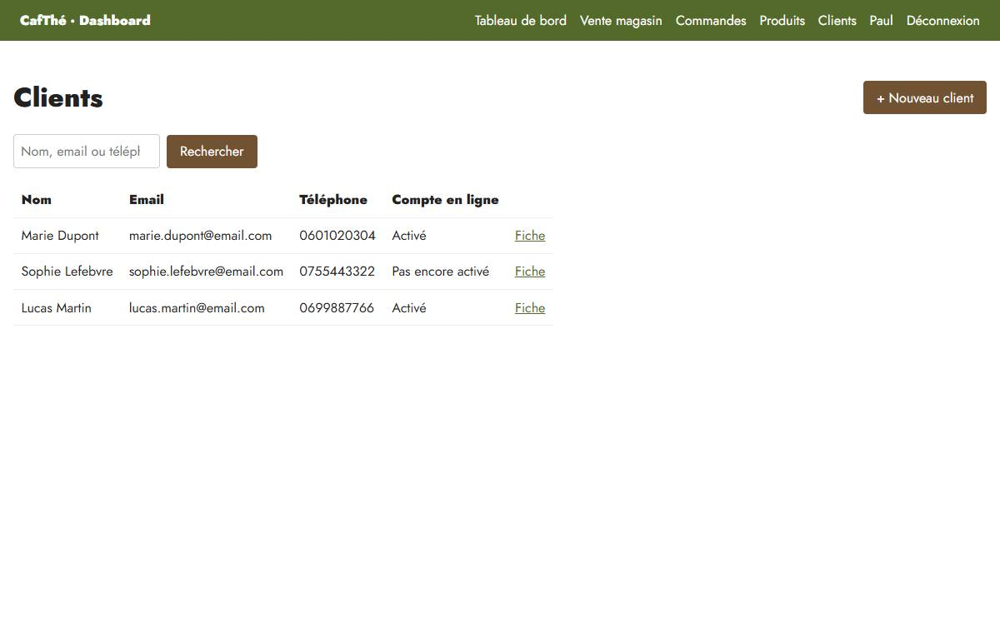

### Rechercher un client

Tapez une partie du nom, de l'email ou du numéro de téléphone puis cliquez sur **Rechercher**.
La colonne **Compte en ligne** indique si le client a déjà choisi un mot de passe sur le site
(« Activé ») ou non (« Pas encore activé »). Cliquez sur **Fiche** pour ouvrir sa fiche.

### Créer une fiche client

Cliquez sur **+ Nouveau client** et remplissez :

- **Nom** (60 caractères maximum) et **Prénom** (20 caractères maximum)
- **Email** : il ne doit pas déjà être utilisé par un autre client
- **Téléphone** : 10 à 15 caractères, chiffres, espaces, « + » et « . » acceptés

Cliquez sur **Créer le client**. La fiche est créée **sans mot de passe** : le client pourra activer
son compte sur le site avec son email, en choisissant lui-même son mot de passe. Vous n'avez donc jamais
à connaître ni à transmettre de mot de passe client.

### Fiche client et statistiques

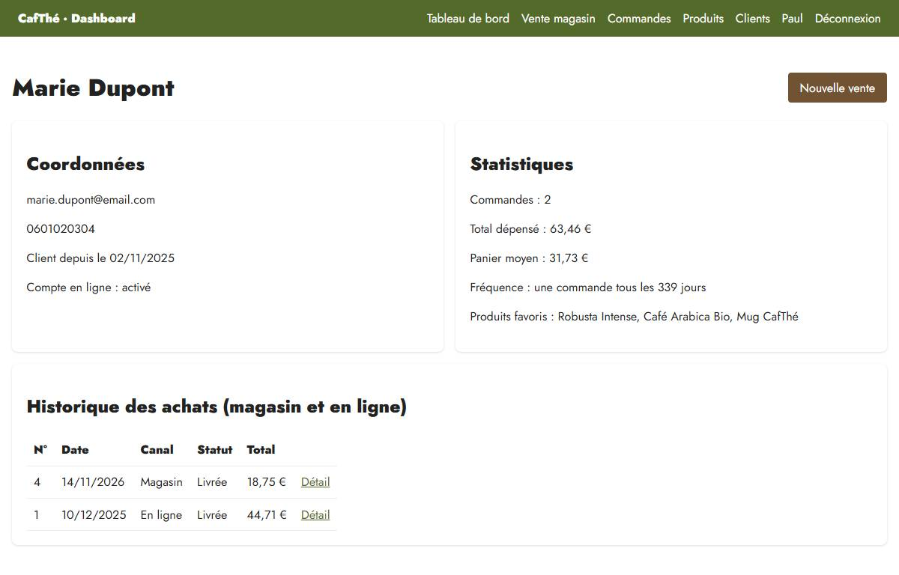

- **Coordonnées** : email, téléphone, date de création, état du compte en ligne.
- **Statistiques** :
  - Commandes : nombre total d'achats (magasin et site)
  - Total dépensé : somme de tous ses achats
  - Panier moyen : montant moyen d'un achat
  - Fréquence : nombre moyen de jours entre deux achats (affiché à partir de deux achats)
  - Produits favoris : les 3 produits qu'il achète le plus
- **Historique des achats** : toutes ses commandes, en magasin et en ligne, avec un lien **Détail**.

Le bouton **Nouvelle vente** ouvre la vente en magasin avec ce client déjà choisi.

---

## 8. Mon profil et mot de passe

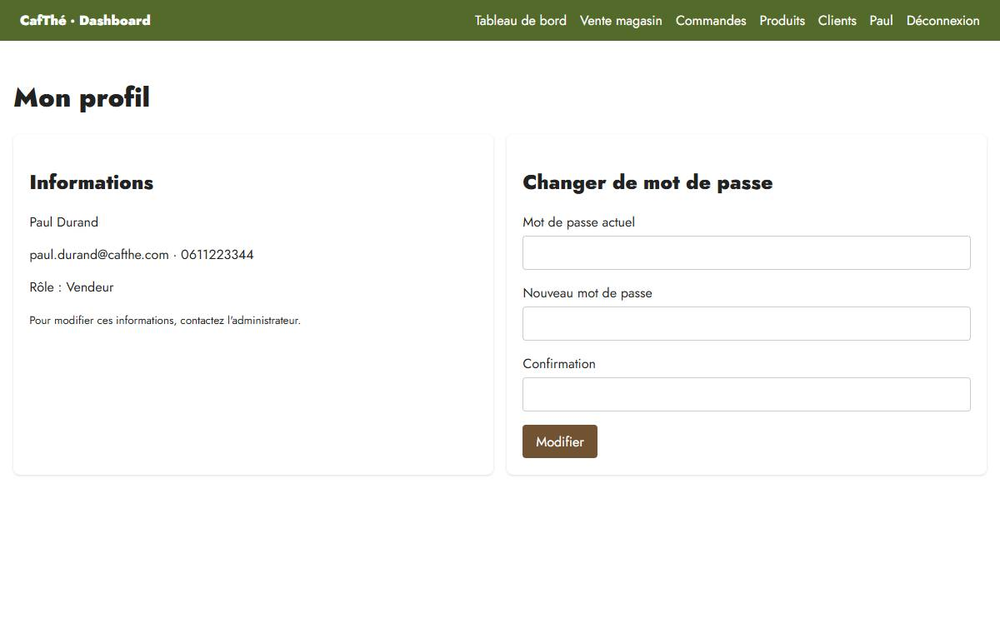

Cliquez sur votre prénom dans le menu.

- **Informations** : nom, email, téléphone et rôle. Pour les modifier, adressez-vous à l'administrateur.
- **Changer de mot de passe** : saisissez le **Mot de passe actuel**, le **Nouveau mot de passe**
  et la **Confirmation**, puis cliquez sur **Modifier**. Le nouveau mot de passe doit contenir au moins
  8 caractères, avec une majuscule, une minuscule et un chiffre.

---

## 9. Administrateur : gestion des vendeurs

Cette partie est réservée au compte administrateur. Le lien **Vendeurs** n'apparaît pas pour un vendeur.

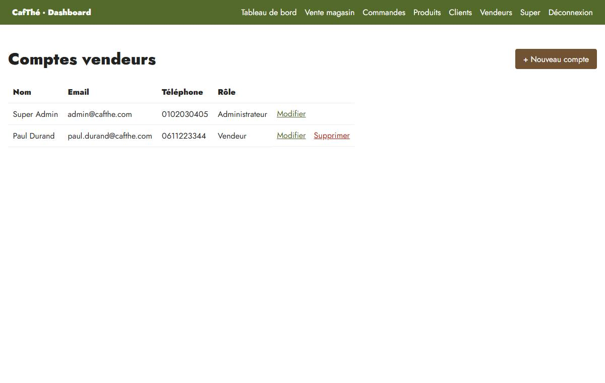

- **Créer un compte** : cliquez sur **+ Nouveau compte**, remplissez Nom, Prénom, Email, Téléphone,
  choisissez le **Rôle** (Vendeur ou Administrateur) et un **Mot de passe** respectant la règle
  (8 caractères, majuscule, minuscule, chiffre), puis cliquez sur **Enregistrer**.
  Transmettez le mot de passe au vendeur, qui pourra le changer depuis son profil.
- **Modifier un compte** : cliquez sur **Modifier**. Laissez le champ mot de passe vide pour ne pas le changer.
- **Supprimer un compte** : cliquez sur **Supprimer** puis confirmez. Vous ne pouvez pas supprimer
  votre propre compte.

Deux comptes ne peuvent pas avoir le même email (« Cet email est déjà utilisé »).
Un vendeur qui a oublié son mot de passe peut aussi utiliser **Mot de passe oublié ?** sur la page de connexion.
